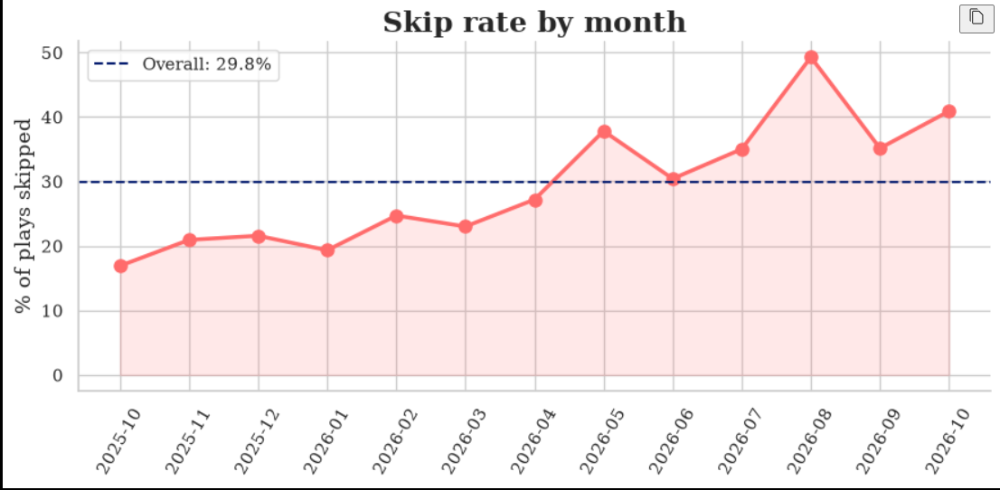
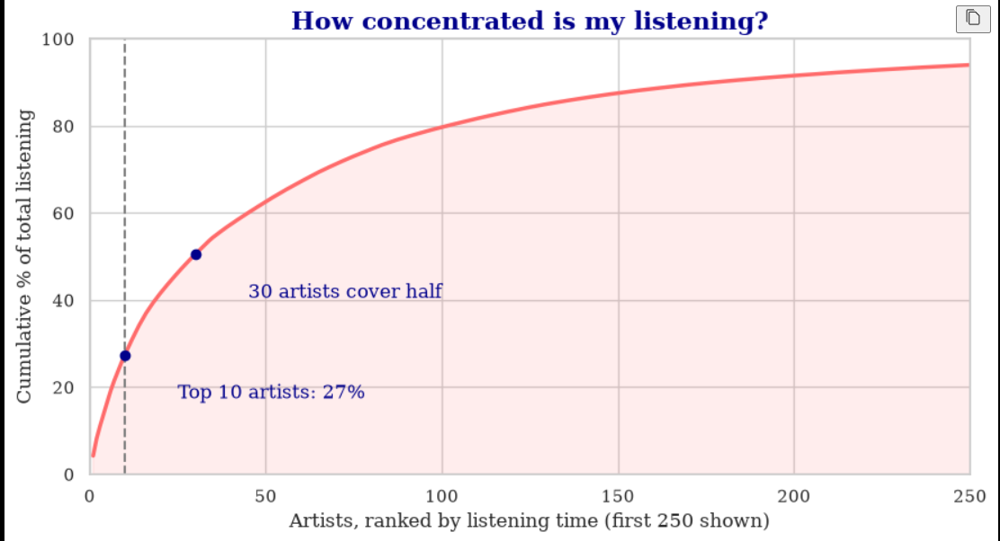
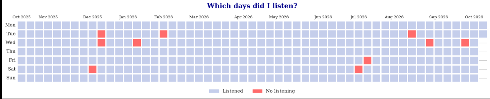
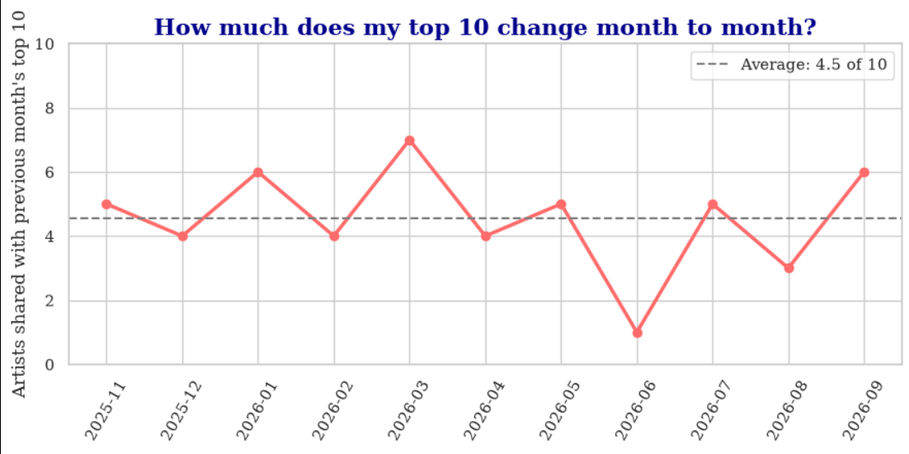

# What a year of Spotify says about me

An end-to-end data analytics project on my own Spotify listening history: loading, inspection, cleaning, feature engineering, analysis and findings, all in one Jupyter notebook.

**Tools:** Python, pandas, NumPy, matplotlib, seaborn, Jupyter

**Data:** Spotify basic account export (streaming history), 6 Oct 2025 to 6 Oct 2026. 23,705 plays across 3 JSON files; 16,632 real plays after cleaning.

---

## Questions

1. **How picky am I as a listener?** What share of my plays do I skip, and does it change over time?
2. **Am I a loyalist or an explorer?** How concentrated is my listening?
3. **How consistently do I listen?** What are my longest streak and longest gap?
4. **How often does my listening pattern change, and what stays constant?** How much does my top 10 change month to month, and how adventurous am I?

## Key findings

### 1. I skip about 30% of what I start, and it's rising
I skipped **7,073 of 23,705 plays (29.8%)**, and 63% of those skips were within the first 5 seconds. My monthly skip rate climbed from **17% in October 2025 to a peak of 49% in August 2026**.



### 2. An explorer with a loyal core
**30 artists** cover half of my listening time and **102** cover 80%, yet my top artist is only 4.2% of the total. **41% of the artists I played, 364 of 883**, I played only once, and together they make up just 1.6% of my listening time.



### 3. Listening is close to a daily habit
I listened on **356 of 366 days (97.3%)**. My longest streak was **157 days**, and I never went more than 2 days without listening.



### 4. My top 10 turns over by about half each month
On average **4.5 of my top 10 artists** carry over from one month to the next, ranging from 7 down to just 1. About a fifth to a third of the artists I play each month are new, but they get only 6 to 21% of my listening time. Only 3 artists made my monthly top 10 in more than half of the 13 months.



## Approach

1. **Inspection:** checked size, date range, duplicates, missing values and outliers. The main issue was that nearly 30% of plays were under 30 seconds.
2. **Cleaning:** converted timestamps from UTC to India time, trimmed names, removed plays under 30 seconds (the point where Spotify counts a stream), and merged title variants of the same song.
3. **Feature engineering:** added date, month, minutes and a combined artist-and-track label.
4. **Analysis:** one section per question, each with a definition, a chart and a written finding.

**Key decisions**
- A **skip** is a play under 30 seconds. Q1 uses the raw data, and Q2 to Q4 use the cleaned data.
- A song is always identified by **artist and track together**, so different songs with the same title stay separate.
- October 2025 is the baseline month for "new artist", and October 2026 (6 days) is excluded from month-to-month charts.

## Limitations

- One year of data from one listener, so these findings describe my own habits and aren't general claims.
- The basic export has no genre, song length or start time, and "new artist" means new within this 12-month window.
- The data shows that my skipping increased, not why.

## Project structure

```
├── README.md
├── requirements.txt
├── .gitignore
├── images/                      # charts used in this README
└── my_spotify_analysis.ipynb    # full analysis
```

## Run it yourself

1. Request your own data from Spotify (Account > Privacy settings > Download your data) and place the `StreamingHistory_music_*.json` files in the same folder as the notebook. My raw data is not included in this repo.
2. Install the libraries: `pip install -r requirements.txt`
3. Open the notebook and run all cells.
